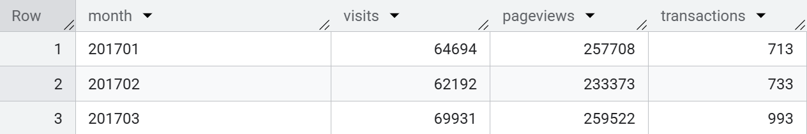
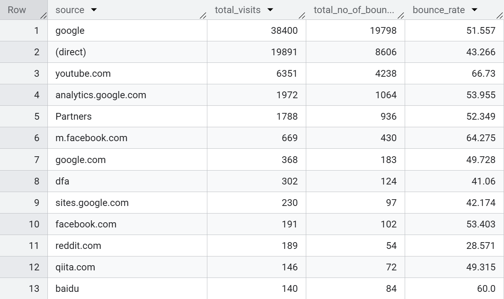
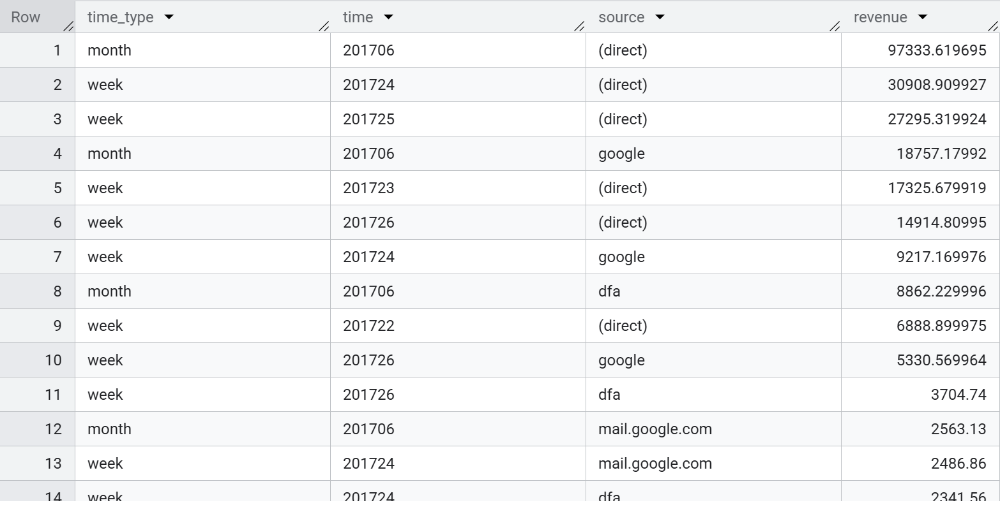
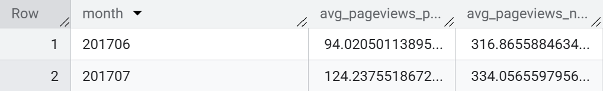
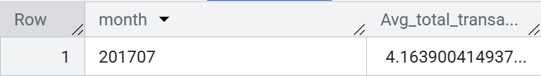
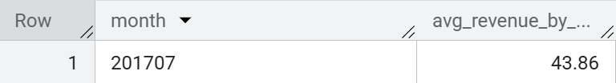
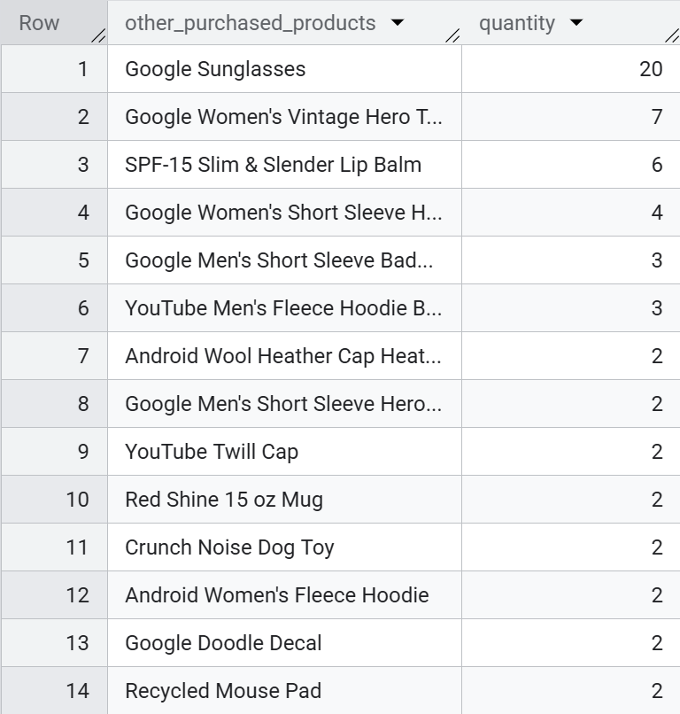
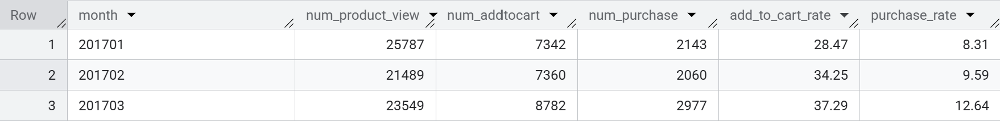

# E-commerce Behavior Analysis with BigQuery


All 8 queries below have been executed and validated directly in Google BigQuery. You can view the live project (queries, execution, and saved results) here:

👉 **[Open in BigQuery Console](https://console.cloud.google.com/bigquery?ws=!1m7!1m6!12m5!1m3!1sgolden-shine-472610-g7!2sus-central1!3s8401e328-64f2-4126-8ffb-c8957fd87998!2e1)**

---

## 📁 Project Overview

| | |
|---|---|
| **Dataset** | [`bigquery-public-data.google_analytics_sample.ga_sessions_2017`](https://console.cloud.google.com/marketplace/product/obfuscated-ga360-data/google-analytics-sample) — real (obfuscated) Google Analytics data from the Google Merchandise Store |
| **Tool** | Google BigQuery (Standard SQL) |
| **Time period analyzed** | January – July 2017 |
| **Focus areas** | Traffic trends, marketing channel performance, revenue attribution, purchaser behavior, cross-sell, conversion funnel |
| **Techniques used** | `UNNEST` on nested/repeated fields, CTEs (`WITH`), window-free aggregation, `_TABLE_SUFFIX` wildcard tables, `FORMAT_DATE`/`PARSE_DATE`, conditional aggregation (`COUNTIF`), self-joins via CTE, `UNION ALL` |

### Why this dataset?

The GA sample dataset stores each **session** as a row, with **hits** (page views, events, e-commerce actions) and **products** nested inside each hit as repeated `RECORD` fields. This mirrors how real analytics/event data is structured in production data warehouses — making it a realistic exercise in writing SQL against **semi-structured, nested data**, not just flat tables.

---

## 🎯 Business Questions & Key Findings

### Query 01 — Monthly Traffic & Conversion Overview (Jan–Mar 2017)

**Query:**
```sql
SELECT format_date("%Y%m",parse_date('%Y%m%d',date)) as month
      ,sum(totals.visits) as visits
      ,sum(totals.pageviews) as pageviews
      ,sum(totals.transactions) as transacitons
FROM `bigquery-public-data.google_analytics_sample.ga_sessions_2017*`
WHERE _table_suffix between '0101' and '0331'
GROUP BY month 
ORDER BY 1;
```

**Result:**



---

### Query 02 — Bounce Rate by Traffic Source (July 2017)

**Query:**
```sql
SELECT trafficSource.`source`
      ,sum(totals.visits) as total_visits
      ,sum(totals.bounces) as total_no_of_bounces
      ,ROUND(
            100* SUM(totals.bounces)/sum(totals.visits)
            ,3) as transactions
FROM `bigquery-public-data.google_analytics_sample.ga_sessions_201707*`
GROUP BY trafficSource.`source`
ORDER BY 2 DESC;
```

**Result:**



---

### Query 03 — Revenue by Traffic Source, Weekly & Monthly (June 2017)

**Query:**
```sql
WITH week_out as 
      (SELECT 'week' as time_type
            ,format_date ('%Y%W',parse_date('%Y%m%d', date)) as week 
            ,trafficSource.`source`
            ,sum(product.productRevenue)/1000000 as revenue
      FROM `bigquery-public-data.google_analytics_sample.ga_sessions_201706*`,
      UNNEST (hits) hits,
      UNNEST (hits.product) product
      GROUP BY week, trafficSource.`source`)

SELECT *
FROM 
      (SELECT 'month' as time_type
            ,'201706' as time 
            ,source
            ,sum(revenue) as revenue
      FROM week_out
      GROUP BY 3
      order by 4 DESC) as month_out 
UNION ALL 
SELECT * 
FROM week_out
ORDER BY revenue DESC;
```

**Result:**



---

### Query 04 — Pageviews: Purchasers vs. Non-Purchasers (Jun–Jul 2017)

**Query:**
```sql
WITH purchase AS 
      (SELECT format_date('%Y%m',parse_date('%Y%m%d', date)) as month 
            ,sum(totals.pageviews) / count(distinct fullVisitorId) as avg_pageviews_purchase
      FROM `bigquery-public-data.google_analytics_sample.ga_sessions_2017*`,
      UNNEST (hits) hits,
      UNNEST (hits.product) product
      WHERE (_table_suffix between '0601' and '0731')
            and totals.transactions >=1 
            and product.productRevenue is not null 
      GROUP BY month)
,non_purchase AS
      (SELECT format_date('%Y%m',parse_date('%Y%m%d', date)) as month 
            ,sum(totals.pageviews) / count(distinct fullVisitorId) as avg_pageviews_non_purchase
      FROM `bigquery-public-data.google_analytics_sample.ga_sessions_2017*`,
      UNNEST (hits) hits,
      UNNEST (hits.product) product
      WHERE (_table_suffix between '0601' and '0731')
            and totals.transactions is null 
            and product.productRevenue is null 
      GROUP BY month)

SELECT *
FROM purchase
INNER JOIN non_purchase USING (month);
```

**Result:**



---

### Query 05 — Avg. Transactions per Purchasing User (July 2017)

**Query:**
```sql
SELECT '201707' as month
      ,sum(totals.transactions)/count(distinct fullVisitorId) as Avg_total_transactions_per_user
FROM `bigquery-public-data.google_analytics_sample.ga_sessions_201707*`,
UNNEST (hits) hits,
UNNEST (hits.product) product 
WHERE totals.transactions >=1 
      and product.productRevenue is not null 
GROUP BY 1;
```

**Result:**



---

### Query 06 — Avg. Revenue per Session, Purchasers Only (July 2017)

**Query:**
```sql
SELECT '201707' as month 
      ,round (
            (sum(product.productRevenue)/sum(totals.visits)) / 1000000
      ,2) as avg_revenue_by_user_per_visit
FROM `bigquery-public-data.google_analytics_sample.ga_sessions_201707*`,
UNNEST (hits) hits,
UNNEST (hits.product) product
WHERE totals.transactions is not null 
      and product.productRevenue is not null 
GROUP BY 1;
```

**Result:**



---

### Query 07 — Cross-Sell Analysis: "YouTube Men's Vintage Henley" (July 2017)

**Query:**
```sql
WITH customer as
      (SELECT fullVisitorId
      FROM `bigquery-public-data.google_analytics_sample.ga_sessions_201707*`,
      UNNEST (hits) hits,
      UNNEST (hits.product) product
      WHERE product.v2ProductName = "YouTube Men's Vintage Henley"
            and product.productRevenue is not null
            and totals.transactions >=1)

SELECT product.v2ProductName as other_purchased_products
      ,sum(product.productQuantity) as quantity 
FROM `bigquery-public-data.google_analytics_sample.ga_sessions_201707*`,
UNNEST (hits) hits,
UNNEST (hits.product) product
WHERE product.productRevenue is not null
      and totals.transactions >=1
      and fullVisitorId in (select fullVisitorId from customer)
      and product.v2ProductName != "YouTube Men's Vintage Henley"
GROUP BY 1
ORDER BY 2 DESC;
```

**Result:**



---

### Query 08 — Conversion Funnel: View → Add-to-Cart → Purchase (Jan–Mar 2017)

**Query:**
```sql
SELECT *
      ,round(100*num_addtocart/num_product_view,2) as add_to_cart_rate
      ,round(100*num_purchase/num_product_view,2) as purchase_rate
FROM
  (SELECT format_date('%Y%m', parse_date('%Y%m%d',date)) as month
        ,countif(hits.eCommerceAction.action_type = '2') as num_product_view
        ,countif (hits.eCommerceAction.action_type = '3') as num_addtocart
        ,countif (hits.eCommerceAction.action_type = '6' and product.productRevenue is not null) as num_purchase
  FROM `bigquery-public-data.google_analytics_sample.ga_sessions_2017*`,
  UNNEST (hits) hits,
  UNNEST (hits.product) product
  WHERE _table_suffix between '0101' and '0331'
  GROUP BY month) as count_out
  ORDER BY month;
```

**Result:**



---

## 🧠 Key Insights & Recommendations

## 🔎 Final Conclusion & Recommendations

| # | Insight | Recommendation |
|---|---------|----------------|
| 1 | **Conversion Growth**: March 2017 had the highest traffic (69,931 visits), but transactions grew much faster than visits (+35.5% vs +12.4% compared with February). From January to March, add-to-cart rate rose from 28.47% to 37.29% and purchase rate from 8.31% to 12.64%. | **Replicate March's Success**: Review the campaigns, promotions and site changes from March 2017, turn what worked into a repeatable campaign plan, and track add-to-cart rate and purchase rate as monthly KPIs. |
| 2 | **Traffic vs. Revenue**: **Google** brings the most visits (38,400 in July 2017), but **Direct** traffic generates most of the revenue: $97.3K in June 2017, about 78% of the top three sources, compared with only $18.8K from Google. | **Reallocate Marketing Budget by Revenue**: Shift **Google Ads** spend toward high-intent keywords that actually convert, and invest in brand awareness and loyalty programs to grow high-value **direct traffic**. |
| 3 | **Bounce Rate by Channel**: **youtube.com** (66.73%) and **m.facebook.com** (64.28%) have the highest bounce rates, suggesting low-intent visitors. **reddit.com** has the lowest bounce rate (28.57%) but only 189 visits. | **Optimize Landing Pages for High-Bounce Channels**: Make YouTube and Facebook ad content match the landing page, improve page load speed, and run a small-budget test on **Reddit** before scaling it up. |
| 4 | **Purchaser Behavior**: Purchasers view far fewer pages than non-purchasers (94 vs 317 in June 2017), make about 4.16 transactions each, and generate around $43.86 per session. They know what they want and come back to buy again. | **Simplify the Path to Purchase & Retain Buyers**: Improve site search and product filters, shorten the checkout process, and launch remarketing and post-purchase email campaigns to bring existing customers back. |
| 5 | **Cross-Selling Opportunity**: Customers who bought the **"YouTube Men's Vintage Henley"** most often also bought **Google Sunglasses** (20 units), nearly 3x more than the next product. | **Launch Product Bundles**: Bundle the **"YouTube Men's Vintage Henley"** with **Google Sunglasses** at a small discount, and add a "Frequently bought together" section on product pages and at checkout. | Apply the same co-purchase analysis to other best-sellers to find more bundles. |
